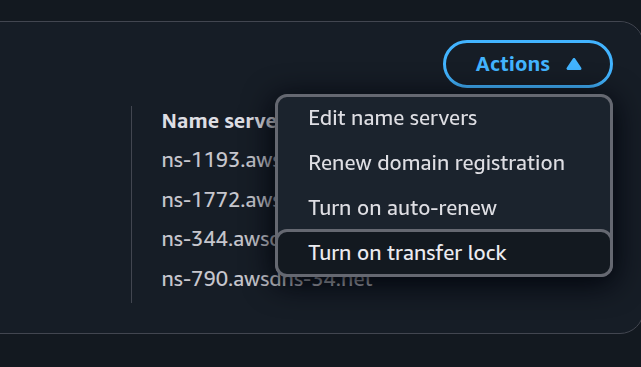

# DNS Configuration

## Context

Polaris needs all communication encrypted. 

To encrypt http traffic, we must use https, which in turn means a domain name that is recognised by a Certificate Authority.

We use [Let's Encrypt](https://letsencrypt.org) to create certificates.

You need domain names that point to each cloud's Kubernetes ingress.
For Kubernetes to point a domain name at a particular pod, you need to prove you own it.

## Summary

1. Buy domain names (e.g. from AWS Route 53)
2. Create DNS zones in each target cloud
3. Update the domain registrar's nameservers to point at the cloud's nameservers
4. Request SSL certificates (e.g. via AWS Certificate Manager or Let's Encrypt)

## Instructions

We assume that you've bought your domain name in AWS and want other cloud providers to manage it.
If you've bought your domain name through other domain registrars (e.g. GoDaddy) the process is similar.

### AWS

For AWS, get the Zone ID for your domain by running:
```shell
aws route53 list-hosted-zones-by-name
```
And then update the `AWS_XXX_DNS_ZONE` values in [configuration](configuration.md) accordingly.

Note the `AWS_ZONE_ID` is for the ELB and the `AWS_XXX_DNS_ZONE` are for the DNS.
Although they are lexically similar (thank AWS for that) they are unrelated concepts.

This is sufficient for DNS but if you want to use https, you'll need to assign a certificate.
In AWS, go to [AWS Certificate Manager](https://eu-west-2.console.aws.amazon.com/acm/certificates/list?region=eu-west-2) and `Request` a certificate for your domain.
You then need to press the `Create Record in Route 53` button to prove you own it.
Note that it might take a few minutes to propagate.

### Azure

Create a DNS zone for the combination of domain name and resource group: 
```shell
az network dns zone create --name $YOUR_DOMAIN --resource-group $AZURE_RESOURCE_GROUP  
```
This will print out some JSON that contains nameservers, for example:
```json
{
  "nameServers": [
    "ns1-02.azure-dns.com.",
    "ns2-02.azure-dns.net.",
    "ns3-02.azure-dns.org.",
    "ns4-02.azure-dns.info."
  ]
}
```
Make a note of these.

If a Kubernetes service is gone but DNS record remains, run the Azure DNS cleanup command:
```shell
az network dns record-set a delete \
  --resource-group afon_resource_group \
  --zone-name emryspolarisazure.click \
  --name "@" \
  --yes
```

### GCP

Create a DNS zone through the GUI.  Note you might need admin rights to do this.

Once it's created, you can run:
```shell
$ gcloud dns managed-zones describe $YOUR_ZONE_NAME --project=$YOUR_PROJECT
```
Just like for Azure, this will create a list of name servers:
```
nameServers:
- ns-cloud-c1.googledomains.com.
- ns-cloud-c2.googledomains.com.
- ns-cloud-c3.googledomains.com.
- ns-cloud-c4.googledomains.com.
```
Again, make a note.

## Domain name registration

Go to the DNS section of your domain registrar.

For AWS, you can use [AWS Route 53](https://us-east-1.console.aws.amazon.com/route53/domains/home).
Click the domain you've bought and in the top right corner, you'll see a section called `Name servers`.
Click the `Actions` button and choose `Edit name servers`.



Now add the list of nameservers your cloud provider gave you. 
They should propagate within about 10 minutes.

## Check DNS propagation

```shell
dig A <domain> +short
```

## Consequences

Kubernetes running in the cloud that owns the DNS servers can now ask them to map a domain name to one of its pods.
