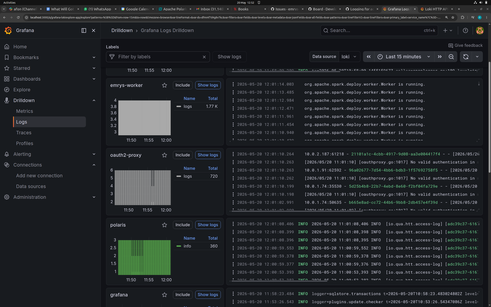
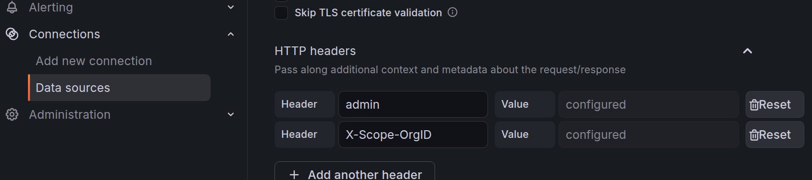
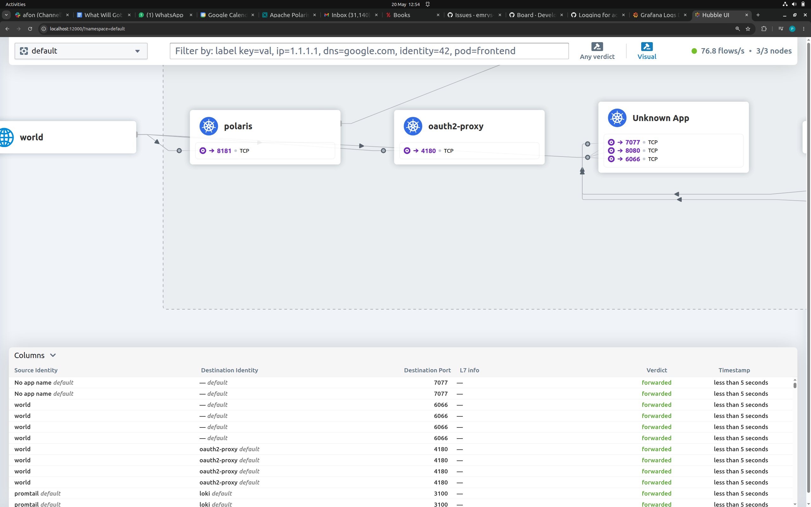

# Monitoring

### Tools

We currently have the following monitoring tools:

- grafana: running locally to view logs and metrics
  - loki: running in the cloud as a grafana data source to view logs. 
  - prometheus: running in the cloud as a grafana data source to capture metrics
- hubble: running hubble-ui in the cloud to view network traffic
- hubble-cli: running locally to query hubble

### Install cloud tools via tofu:

To install all the cloud tools, assume AWS full stack has been deployed. 
If not, deploy using command:
```shell
./afon.sh -a exec --exec-class cdk.aws.DeployAwsFullStack
```

### Set up kube port-forwarding 

Set up cloud port-forward for the tools you want to access:
```shell
kubectl port-forward svc/loki 3100:3100 # loki
kubectl port-forward svc/kube-prometheus-stack-prometheus 9090:9090 # prometheus
kubectl port-forward svc/hubble-ui -n kube-system 12000:80   # hubble-ui
kubectl port-forward svc/hubble-relay -n kube-system 4245:80 # hubble-cli
```

### Grafana 
Run grafana via docker:

```shell
docker run -d --name grafana -p 3000:3000 grafana/grafana 
```
Open the Grafana UI at `http://localhost:3000` and login with credentials `admin`/`admin`.

#### Save local Grafana config
You can run your dockerized Grafana persisting the config each time with:
```shell
docker run -d --name grafana -p 3000:3000 -v $LOCAL_GRAFANA_CONFIG_DIR:/var/lib/grafana grafana/grafana
```
To save all the metadata files the first time:
```shell
docker cp YOUR_CONTAINER_ID:/var/lib/grafana $LOCAL_GRAFANA_CONFIG_DIR
```
**Note** you may need to execute `sudo chown -R 472:472 $LOCAL_GRAFANA_CONFIG_DIR` to give Grafana permissions.
User/group 472 is the Grafana user.



### Loki

In Grafana UI, add a Loki Data Source pointing to`http://localhost:3100`.

NOTE: In `HTTP headers` add a single entry with:
- Header name `X-Scope-OrgID` and as value the cluster name (`CLUSTER_NAME` from `config/afon.properties`).



You should now be able to logs in `Drilldown -> Logs` in the Grafana GUI.
You may need to refresh your browser.

Loki persists its logs to the bucket defined by `AWS_S3_BUCKET_NAME` in `afon-aws.properties`.

NOTE: On macos, if getting connection refused when adding the data source, use http://host.docker.internal:3100 in place of http://localhost:3100

### Prometheus

In Grafana UI, add a Prometheus Data Source pointing to `http://localhost:9090` 
One should see nearly 2000 metrics.

NOTE:  On macos, if getting connection refused when adding the data source, use http://host.docker.internal:9090 in place of http://localhost:9090 (see https://github.com/grafana/grafana/issues/46434).  

### Hubble

#### Hubble UI
Once the hubble-ui kube tunnel is setup, the Hubble UI is available at `http://localhost:12000` 
One should see the network flows between pods.



#### Hubble CLI
Install the Hubble CLI client: 
- linux: [Hubble CLI](https://docs.cilium.io/en/stable/observability/hubble/setup/)
- macos: brew install hubble

Once the hubble-relay kube port-forward is set up the hubble CLI is avalaible by running:

```shell
hubble observe
```
 
This will print out something akin to `netstat` in Linux:

```shell
$ hubble observe
Jun  1 09:05:34.677: 10.0.1.196:40327 (host) -> 18.169.47.27:443 (world) to-network FORWARDED (TCP Flags: ACK, PSH)
Jun  1 09:05:35.097: 10.0.1.196:46270 (host) -> 18.169.47.27:443 (world) to-network FORWARDED (TCP Flags: ACK)
Jun  1 09:05:36.323: 10.0.2.139 (remote-node) -> 10.0.1.24 (health) to-endpoint FORWARDED (ICMPv4 EchoRequest)
Jun  1 09:05:36.323: 10.0.2.139 (remote-node) <- 10.0.1.24 (health) to-network FORWARDED (ICMPv4 EchoReply)
Jun  1 09:05:36.323: 10.0.2.139:55266 (remote-node) -> 10.0.1.24:4240 (health) to-endpoint FORWARDED (TCP Flags: ACK, PSH)
Jun  1 09:05:36.324: 10.0.2.139:55266 (remote-node) <- 10.0.1.24:4240 (health) to-network FORWARDED (TCP Flags: ACK, PSH)
...
```

### Blob storage size

AWS: 
```shell
aws s3 ls s3://emrys-afon-bucket/acceptancetests/ --recursive --summarize | grep "Total Size
```

Azure:
```shell
az storage blob list   --account-name afonstorageaccount   --container-name afonstorage  --prefix acceptancetests/   --query "[].properties.contentLength"   --output tsv | awk '{sum+=$1} END {printf "%.2f kb\n", sum/1024}'
```

GCP:
```shell
gcloud storage du -s gs://emrys_afon_core/acceptancetests/**
```

